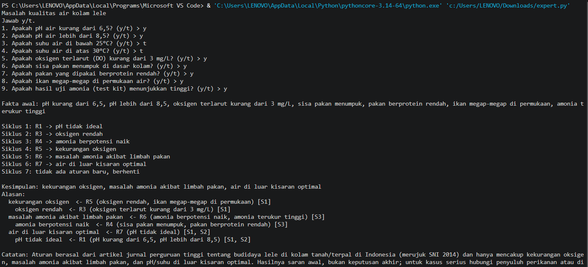
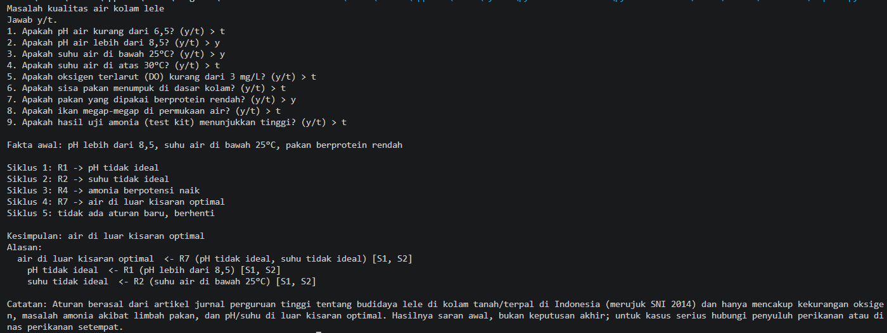
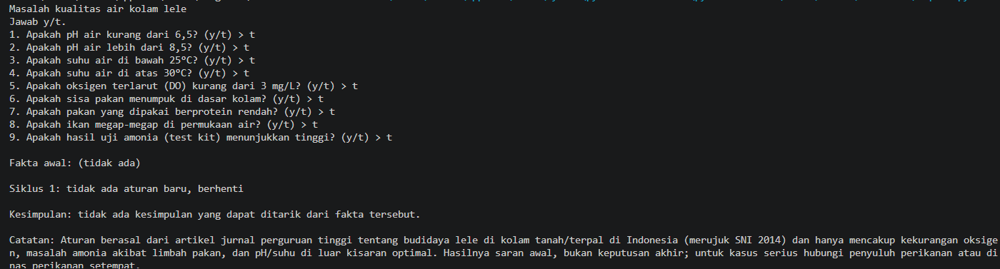

# Tugas 5 AI: Sistem Pakar Kualitas Air Kolam Lele

**Nama:** (Muhammad izzul islam)  
**NIM:** (F1D02410077)

## Topik dan cara menjalankan

Topik: diagnosis awal masalah kualitas air kolam lele (kekurangan oksigen, masalah amonia akibat limbah pakan, pH/suhu di luar kisaran optimal).

Bahasa: Python 3.8 atau lebih baru, tanpa library tambahan (hanya `json`, `argparse`, `pathlib`).

```bash
python expert.py                                   # mode tanya-jawab y/t
python expert.py --fakta "sisa pakan menumpuk;amonia terukur tinggi"   # fakta "ya" langsung
python expert.py --uji                             # jalankan semua kasus uji
```

Berkas: `kb_lele.json` (aturan dan sumber), `expert.py` (mesin forward chaining).

## Sumber

| Kode | Sumber |
|---|---|
| S1 | Sugianti dan Hafiludin. *Manajemen Kualitas Air pada Pembenihan Ikan Lele Mutiara (Clarias gariepinus)*. Juvenil, Universitas Trunojoyo Madura. https://journal.trunojoyo.ac.id/juvenil/article/download/15813/7090. Diakses 13 Nov 2026. Memuat kisaran optimal menurut SNI 2014: pH 6,5-8,5; DO >3 mg/L; suhu 25-30°C. |
| S2 | Haryasakti dkk. *Efektivitas Bakteri Fotosintetik Rhobac dalam Meningkatkan Kualitas Air pada Budidaya Ikan Lele di Kolam Terpal*. Sekolah Tinggi Pertanian Kutai Timur. https://ojs.stiperkutim.ac.id/index.php/jpt/article/download/610/296. Diakses 13 Nov 2026. Memuat suhu 25-30°C, pH 6,5-8,5, DO 5 mg/L. |
| S3 | *Pengaruh kandungan pakan komersial berbeda terhadap kualitas air budidaya benih ikan lele mutiara (Clarias gariepinus)*. Jurnal Akuakultur, Universitas Dharmawangsa. https://jurnal.dharmawangsa.ac.id/index.php/akuakultur/article/download/7084/pdf. Diakses 13 Nov 2026. Memuat temuan bahwa pakan berprotein rendah memicu kenaikan amonia, TDS, dan pH. |

## Tabel aturan

| Aturan | IF | THEN | Sumber |
|---|---|---|---|
| R1 | pH kurang dari 6,5 OR pH lebih dari 8,5 | pH tidak ideal | S1, S2 |
| R2 | suhu di bawah 25°C OR suhu di atas 30°C | suhu tidak ideal | S1, S2 |
| R3 | oksigen terlarut kurang dari 3 mg/L | oksigen rendah | S1 |
| R4 | sisa pakan menumpuk OR pakan berprotein rendah | amonia berpotensi naik | S3 |
| R5 | oksigen rendah AND ikan megap-megap di permukaan | **kekurangan oksigen** | S1 |
| R6 | amonia berpotensi naik AND amonia terukur tinggi | **masalah amonia akibat limbah pakan** | S3 |
| R7 | pH tidak ideal OR suhu tidak ideal | **air di luar kisaran optimal** | S1, S2 |

Ada 7 aturan dan 3 kesimpulan akhir (cetak tebal). R5 memakai hasil R3, R6 memakai hasil R4, R7 memakai hasil R1 dan R2.

## Metode: forward chaining

Dipilih karena sifat masalahnya "ada gejala, cari penyebab", dan alurnya mudah dijelaskan dan dilacak. Mesin ditulis sendiri di `expert.py`:

1. Program menanyakan fakta yang tidak pernah menjadi hasil aturan, lalu menyimpan jawaban "ya" ke memori.
2. Cari aturan yang syaratnya terpenuhi (mode `dan`: semua ada, mode `atau`: salah satu) dan hasilnya belum ada di memori.
3. Jalankan aturan pertama yang cocok, tambahkan hasilnya ke memori, catat aturan asalnya untuk alasan.
4. Ulangi sampai tidak ada aturan baru.
5. Kesimpulan akhir adalah hasil yang tidak dipakai sebagai syarat aturan lain. Alasan ditelusuri mundur lewat catatan aturan asal.

## Kasus uji dan screenshot

| # | Jawaban "ya" | Kesimpulan |
|---|---|---|
| 1 | DO kurang dari 3 mg/L, ikan megap-megap | kekurangan oksigen |
| 2 | ikan megap-megap saja | tidak ada (negatif) |
| 3 | pH lebih dari 8,5, DO kurang dari 3 mg/L, ikan megap-megap | kekurangan oksigen, air di luar kisaran optimal |
| 4 | sisa pakan menumpuk, amonia terukur tinggi | masalah amonia akibat limbah pakan |





## Batas keberlakuan

Pengetahuan dalam sistem ini diambil dari tiga artikel jurnal perguruan tinggi Indonesia yang merujuk SNI 2014 dan literatur budidaya lele, jadi berlaku untuk budidaya lele di kolam air tawar tropis dengan kisaran pH, suhu, dan oksigen terlarut seperti pada sumber. Cakupannya hanya kekurangan oksigen, masalah amonia akibat limbah pakan, dan pH/suhu di luar kisaran optimal; penyakit ikan, nitrit, dan kualitas air sistem bioflok atau RAS tidak tercakup. Hasilnya adalah saran awal, bukan keputusan akhir, dan untuk kasus serius sebaiknya berkonsultasi dengan penyuluh perikanan atau dinas perikanan setempat. Catatan yang sama ditampilkan di setiap keluaran program.

## Penggunaan alat bantu AI

(Isi sesuai kenyataan, misalnya: "Claude dipakai untuk membantu mencari sumber dan menyusun kerangka kode; aturan dan kode sudah saya pahami dan jelaskan sendiri.")
